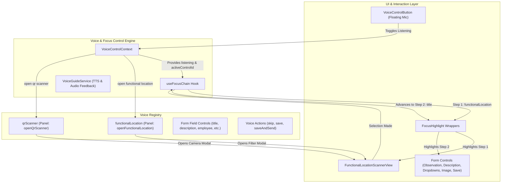

# Voice Command Automation & Focus Highlight Integration Guide
## OTG Capture Screen (`OtgCaptureScreen.tsx`)

---

## 1. Executive Summary

This document explains how voice command automation, guided focus highlights, and step-by-step auto-progression are implemented in `d:\pf\src\screens\suggestion\OtgCaptureScreen.tsx`, replicating the proven architecture from `SuggestionFormScreen.tsx`.

The goal is to provide a hands-free, voice-assisted data entry experience for operators in the field, while preserving 100% of the existing manual interaction flow (typing, tapping, manual dropdown selection, and barcode scanning remain completely intact).

---

## 2. What Happens in Voice-Assisted Mode

1. **Starts at Step 1: Functional Location**:
   - The highlight immediately pulses on **Functional Location** (`STEP 1 OF 7`).
   - Voice announces: *"Please select functional location or scan QR. You can say open functional location or open QR scanner"*.
2. **Two Dedicated Panel Triggers**:
   - Saying **"open functional location"** opens the **Functional Location hierarchy filter** popup.
   - Saying **"open qr scanner"** opens the **Camera QR Scanner**.
   - Speech recognition pauses when the camera scanner opens and automatically resumes when closed.
3. **Automatic Progression to Observation**:
   - Once a location is selected or scanned, focus advances to **Observation** (`STEP 2 OF 7`).
   - Voice assistant dictates your observation and stops on *"done"*.
4. **Description & Details**:
   - Focus moves to **Description / Suggestion** (`STEP 3 OF 7`) for voice dictation.
   - Focus moves to **Image Upload** (`STEP 4 OF 7`), prompting: *"Do you want to upload an image?"*
   - Focus advances through **Type**, **Priority**, and **Employee**.
5. **Ready to Save**:
   - When mandatory fields are filled, the save footer pulses with **`READY TO SAVE`**.
   - Saying **"save"** saves a draft; saying **"save and send to leader"** submits to leader.

---

## 3. Architecture & State Mind Map

---

## 4. Voice Commands Reference

| Spoken Command | Target / Action | Behavior |
| :--- | :--- | :--- |
| **"open functional location"** | Functional Location Panel | Opens hierarchy selection modal |
| **"open qr scanner"** | QR Scanner | Opens the camera barcode scanner |
| **"enter observation"** / auto | Observation | Dictates title text |
| **"enter description"** / auto | Description | Dictates multiline description |
| **"yes" / "open camera"** | Image Upload | Launches vision camera for photo |
| **"no" / "skip"** | Image Upload | Skips photo capture |
| **"abnormality" / "lesson" / ...** | Type | Selects capture type (ABN, OPL, KZN, APL) |
| **"low" / "medium" / "high" / "critical"** | Priority | Selects priority |
| **"open employee"** | Employee | Opens dropdown to select employee |
| **"check others" / "uncheck others"** | OTHERS | Toggles outside employee checkbox |
| **"skip"** | Current Step | Skips optional field (warns on required) |
| **"save"** | Save Draft | Submits draft (`performSave(false)`) |
| **"save and send to leader"** | Submit | Submits to leader (`performSave(true)`) |
| **"stop listening"** | Voice Control | Turns off voice assistant |
